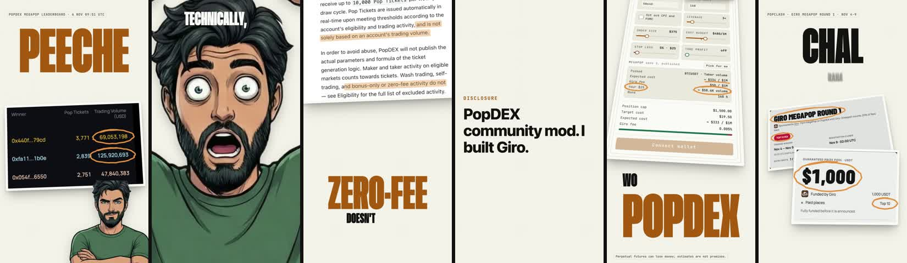
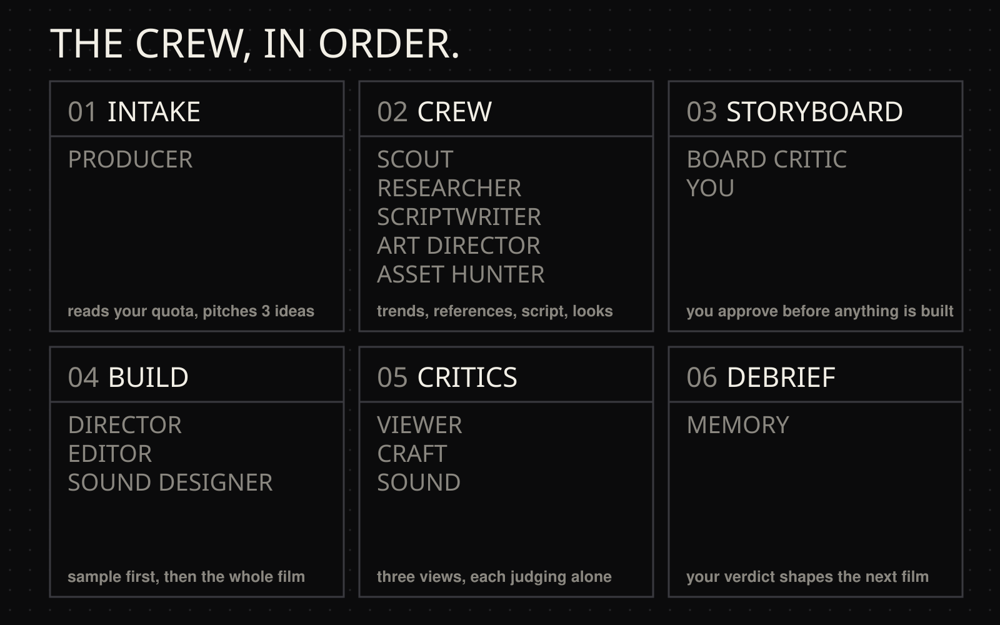

<p align="center"></p>

# motion-director

**You are not a video editor. You have an idea. That is enough.**

motion-director is a skill for Claude Code that works like a film crew. You type one line, or drop in your footage or your voice. Nine agents and four critics plan it, storyboard it, build it, judge it and hand you an MP4 with an honest score.

| You bring | The crew brings |
|---|---|
| One line, a story, a reference video, raw clips or a voice take | Producer, scout, researcher, scriptwriter, art director, asset hunter, editor, sound designer, critics |
| Your taste, one tap at a time | A memory of everything you liked and rejected |

## Real films it made

<p align="center"></p>

A 6 s countdown loop for a trading competition, Short tier. Verdict: "Love it".

<p align="center"></p>

Six frames from a 99 s vertical Short in Hinglish, Grand tier. It took 8 versions to ship; the last one was posted on Instagram and YouTube Shorts.

The full record from the author's first 13 cuts (28 Oct to 13 Nov 2026): 4 approved, 3 rejected, 3 sent back for fixes, 3 with no verdict logged. The rejections are why the memory exists.

## Start in 3 steps

```bash
git clone https://github.com/ilhanEdu/motion-director.git ~/.claude/skills/motion-director
```

```bash
sh ~/.claude/skills/motion-director/scripts/setup.sh
```

Then open Claude Code and type:

```
/motion-director a 30 s Short about my app's new feature
```

Or tell your agent: "Install the skill from https://github.com/ilhanEdu/motion-director".

`setup.sh` prints `ok` or `MISS` for each tool (ffmpeg, Node 22+, uv, Google Chrome, npm; Blender and gh are optional). Install what it lists as `MISS`. Check the install any time with `sh ~/.claude/skills/motion-director/scripts/selftest.sh`.

## Say this

| You type | What happens |
|---|---|
| `/motion-director a 30 s Short about <your idea>` | Full film from one line |
| `/motion-director make it like this video: <link>` | The scout measures the reference (cut rate, type, palette, pace) and the crew adopts the method in your brand |
| `/motion-director edit these clips into a reel: <folder>` | Your footage, cut to the beat, motion design inside the shots |
| `/motion-director I want to talk on camera about <topic>` | Script and shoot guide first. You record. The edit follows your words |
| `/motion-director what's trending` | A sweep of current edits, tools and sounds, filed into the crew's playbooks |
| `/motion-director learn from this: <link>` | The crew reads it and keeps what fits your taste |

<p align="center"></p>

## How a film gets made

1. **Intake.** The producer checks how much of your plan's quota is left, then pitches 3 ideas, each with why it works and its risk. If the film is bigger than what you have left, it tells you the numbers and offers a split: part today, the rest after your limit resets.
2. **Crew.** Trends, references, script, looks and assets, in parallel. Only the agents your budget tier pays for run.
3. **Storyboard.** A hand-drawn sheet, one panel per shot, with the words, the sound and the B-roll. A board critic checks it before you see it. You approve, or name the panels to change.
4. **Your part.** For a talking video you get a shoot guide: what to record, how, which lines, and exact prompts for anything you need to generate.
5. **Sample.** For anything over 30 s you see the first 10 to 15 s finished and say yes before the rest is built.
6. **Build.** GSAP, Remotion, three.js or Blender, picked per shot. Real recorded sound on every event.
7. **Critics.** Three views, each judging alone: a viewer who never read the brief, a craft critic, a sound critic. The lowest score stands.
8. **Debrief.** One tap: "Love it", "Mostly good" or "Redo parts". Your words go into memory. Then it asks before cleaning up the working files.

This is the real sheet the skill draws before it builds anything (rendered from the example file in this repo):

<p align="center"></p>

## The crew

| Agent | Model | Job |
|---|---|---|
| Producer | sonnet | Reads your quota, judges what will work, 3 pitches, the budget |
| Scout | sonnet | Trends, new tools, links you share. Upgrades the crew's playbooks |
| Researcher | sonnet | 5 to 10 real reference films and the techniques behind them |
| Scriptwriter | sonnet, opus on Grand | Concepts, dialogue, voiceover, shoot guide, storyboard panels |
| Art director | sonnet, opus on Grand | Visual directions with real styleframes on one board |
| Asset hunter | sonnet | Your real logo and screenshots, licensed music with measured BPM, B-roll |
| Editor | sonnet | Your voice or footage: transcript, clean take, word timeline, beat cuts |
| Sound designer | sonnet | Real licensed sounds on every event, your voice first, -14 LUFS |
| Critic | opus and sonnet | One agent, four lenses run apart: board, viewer, craft, sound |
| Director | your session | Runs the crew, does the build, logs your feedback |

## Three budget tiers

| Tier | For | Choices you see | Critics |
|---|---|---|---|
| Short | A reel, a Short, a repeat format | 1 concept, 1 look | 1 pass and 1 fix |
| Standard | A promo, an episode | 2 concepts, 2 looks | Board, viewer and craft, up to 2 loops |
| Grand | A launch film | 2 concepts, 3 looks | All four lenses, up to 3 loops |

The producer picks the smallest tier that can do the job and you approve it once.

## It learns you

Everything it learns lives in `~/.claude/motion-director/`, outside this repo, so `git pull` updates the crew and never touches your memory.

| File | Holds |
|---|---|
| `PROFILE.md` | Your taste, banned looks, wording rules |
| `TASTE.md` | What you liked and rejected, in your exact words |
| `STYLES.md` | Each film's style, so the next film is never the last one's template |
| `SPEND.md` | The measured cost of every agent run, so budgets come from your own numbers |
| `LESSONS.md`, `DIGEST.md` | What went wrong in production, and the standing lessons per role |
| `TRENDS.md`, `SOURCES.md`, `MUSIC.md` | Dated trends, tools, and a vetted music library |
| `playbooks/` | One per crew role. Techniques are marked proven or dropped by your verdicts |

The core rules in this repo never change on their own. A rule change is proposed and applied only when you say yes.

## Rules the crew does not break

- Real data only. No invented numbers, quotes or UI.
- Hook in the first 2 seconds. Headlines of 1 to 3 words, never cropped.
- Every cut on a measured beat or a spoken word. Every event has a real recorded sound.
- No film reaches you before the critics have seen it.
- It never posts or uploads anything. You do that.

## Limits

- Built and tested on macOS with Claude Code. Linux and Windows are untested, and one script (`matte.swift`) is Mac only.
- The folder must sit at `~/.claude/skills/motion-director`. The crew's files point there.
- Claude cannot hear. Sound is measured with earshot, never guessed.
- Generated footage needs your own Gemini, Veo or Midjourney. The crew writes the prompts.
- It is not cheap on quota. Measured on one Standard film: board critic 115,289 tokens, viewer critic 93,105 to 129,867, craft and sound critic 191,457. On a small plan, start with a 6 s loop on the Short tier.
- A full render of a 2 min film can take close to an hour. The crew renders stills first and patches changed beats instead of re-rendering.
- Plans report quota as a percent, and only some apps show it to the agent (the Claude desktop app does). Elsewhere it asks you for your `/usage` numbers. Token budgets per agent are instructions plus measurement, not a hard stop.
- Memes and movie clips are copyrighted. They are used only if your profile allows it, at your risk.

## Licence

MIT, see `LICENSE`. Third-party tools that `setup.sh` downloads keep their own licences.
