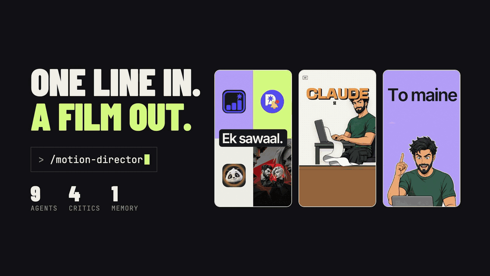
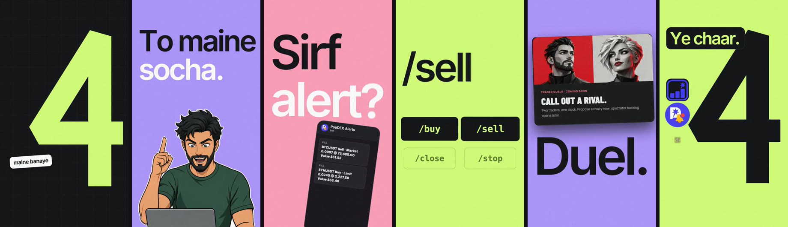
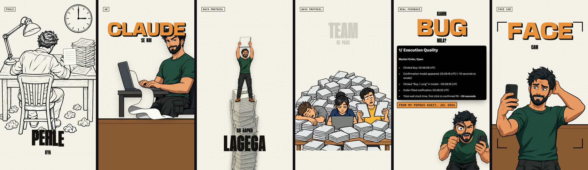
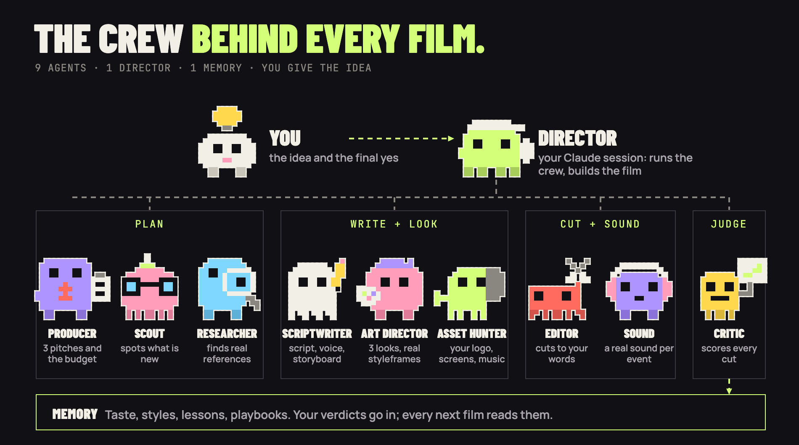
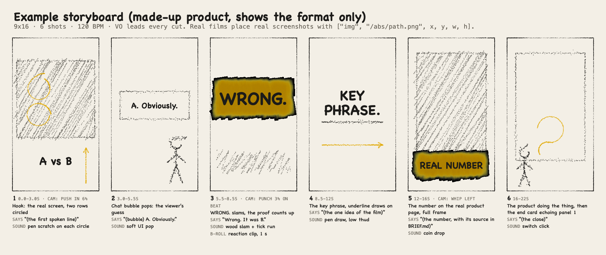

<p align="center"></p>

<h3 align="center">A film crew inside Claude Code. You bring the idea. It hands you the MP4.</h3>

<p align="center">9 agents &nbsp;·&nbsp; 4 critics &nbsp;·&nbsp; 1 memory of your taste &nbsp;·&nbsp; MIT &nbsp;·&nbsp; macOS</p>

```bash
git clone https://github.com/ilhanEdu/motion-director.git ~/.claude/skills/motion-director
sh ~/.claude/skills/motion-director/scripts/setup.sh
```

Then, in Claude Code:

```
/motion-director a 30 s Short about my app's new feature
```

## Made with it

Every frame below is from a finished film, not a mockup.



**Chaar tools, ek ecosystem.** 133 s vertical reel, Hinglish voiceover, real app screens. Author's verdict: *"this is a good video ... I want to keep it as it is"*



**Soch nahi sakta.** 101 s talking reel, recorded voice first, real proof screenshots. Author's verdict: liked, shipped as v5.

The honest record from the author's first 13 cuts: **4 approved, 3 rejected, 3 sent back, 3 unrated.** Each rejection went into memory, and the later films are the ones that shipped.

## What you can say

| You type | You get |
|---|---|
| `/motion-director a 30 s Short about <idea>` | A full film from one line |
| `/motion-director I want to talk on camera about <topic>` | A script and shoot guide first, then an edit cut to your words |
| `/motion-director edit these clips into a reel: <folder>` | Your footage cut to the beat, motion design inside the shots |
| `/motion-director make it like this video: <link>` | The method of a reference (cut rate, type, pace) in your brand |
| `/motion-director what's trending` | A sweep of current edits, tools and sounds |

## How a film gets made

<p align="center"></p>

1. **Pitch.** The producer reads your quota and pitches 3 ideas, each with what works and what could fail.
2. **Storyboard.** A hand-drawn sheet, one panel per shot, before anything renders.
3. **Build.** GSAP, Remotion, three.js or Blender, picked per shot. A real recorded sound on every event.
4. **Critics.** A viewer who never read the brief, a craft critic and a sound critic. The lowest score stands.
5. **Debrief.** You tap "Love it", "Mostly good" or "Redo parts". Your exact words go into memory.

## What is real, and what is not

The agents are Claude subagents, each with a written job, its own inputs and outputs, and real tools it must run. Nothing is faked with a prompt alone.

| Job | What actually runs |
|---|---|
| Hear the sound | [earshot](https://github.com/Leonxlnx/earshot): an audio model that tags sounds, scores speech vs music, and measures LUFS, peaks and onsets |
| Catch a bad recording | `aes.py`: Meta's [audiobox-aesthetics](https://github.com/facebookresearch/audiobox-aesthetics) scores your voice take and the final mix for noise, echo and distortion. It is never used to pick music |
| Time your words | Whisper word timestamps, then `align.py` puts the script's spelling on them (Hinglish included) |
| Find the beat | `beats.py`: [beat_this](https://github.com/CPJKU/beat_this) finds beats and bar starts, librosa when it is not installed. BPM, beat grid, bars in frames |
| Check the picture | `qa.sh`: contact sheet, cut-by-cut continuity strips, frame-by-frame jitter, loudness |
| Render | `render.mjs`: frame-exact headless Chrome with real motion blur |

The limits, plainly: earshot measures sound, it does not have taste. Neither does audiobox-aesthetics: in testing it rated the music bed the author rejected as "lame" above the one they picked. It can tell you the mix is clean and the voice leads, not that the music is good. That call is yours, and the memory keeps it. The first film for a new user runs on the default rules; it gets closer to your taste with every verdict.

<details>
<summary><b>See a real storyboard</b></summary>
<br>

</details>

<details>
<summary><b>The crew</b></summary>

| Agent | Model | Job |
|---|---|---|
| Producer | sonnet | Reads your quota, judges what will work, 3 pitches, the budget |
| Scout | sonnet | Trends, new tools, links you share. Upgrades the crew's playbooks |
| Researcher | sonnet | 5 to 10 real reference films and the techniques behind them |
| Scriptwriter | sonnet, opus on Grand | Concepts, dialogue, voiceover, shoot guide, storyboard panels |
| Art director | sonnet, opus on Grand | Visual directions with real styleframes on one board |
| Asset hunter | sonnet | Your real logo and screenshots, licensed music with measured BPM, B-roll |
| Editor | sonnet | Your voice or footage: transcript, clean take, word timeline, beat cuts |
| Sound designer | sonnet | Real licensed sounds on every event, your voice first, -14 LUFS |
| Critic | opus and sonnet | One agent, four lenses run apart: board, viewer, craft, sound |
| Director | your session | Runs the crew, does the build, logs your feedback |
</details>

<details>
<summary><b>Budget tiers</b></summary>

| Tier | For | Choices you see | Critics |
|---|---|---|---|
| Short | A reel, a Short, a repeat format | 1 concept, 1 look | 1 pass and 1 fix |
| Standard | A promo, an episode | 2 concepts, 2 looks | Board, viewer and craft, up to 2 loops |
| Grand | A launch film | 2 concepts, 3 looks | All four lenses, up to 3 loops |

The producer picks the smallest tier that can do the job, and you approve it once. If the film won't fit your quota, it says so with the numbers and offers a split: part today, the rest after your limit resets.
</details>

<details>
<summary><b>How it learns you</b></summary>

Everything it learns lives in `~/.claude/motion-director/`, outside this repo, so `git pull` updates the crew and never touches your memory.

| File | Holds |
|---|---|
| `PROFILE.md` | Your taste, banned looks, wording rules |
| `TASTE.md` | What you liked and rejected, in your exact words |
| `STYLES.md` | Each film's style, so the next film never reuses the last one's template |
| `SPEND.md` | The measured cost of every agent run |
| `LESSONS.md`, `DIGEST.md` | What went wrong in production, and the standing lessons per role |
| `playbooks/` | One per crew role. Techniques are marked proven or dropped by your verdicts |

Core rules never change on their own. A rule change is proposed, and applied only when you say yes.
</details>

<details>
<summary><b>Rules the crew does not break</b></summary>

- Real data only. No invented numbers, quotes or UI.
- Hook in the first 2 seconds. Headlines of 1 to 3 words, never cropped.
- Every cut on a measured beat or a spoken word. Every event has a real recorded sound.
- No film reaches you before the critics have seen it.
- It never posts or uploads anything. You do that.
</details>

<details>
<summary><b>Cost, setup and limits</b></summary>

- **Quota.** Measured on one Standard film: board critic 115,289 tokens, viewer critic 93,105 to 129,867, craft and sound critic 191,457. On a small plan, start with a 6 s loop on the Short tier.
- **Time.** A full render of a 2 min film can take close to an hour. The crew renders stills first and patches changed beats instead of re-rendering.
- **Tools.** `setup.sh` prints `ok` or `MISS` for ffmpeg, Node 22+, uv, Google Chrome and npm (Blender and gh are optional). Install what it lists as `MISS`. Third-party skill repos are pinned to tested commits. Check the install any time with `sh ~/.claude/skills/motion-director/scripts/selftest.sh`, and add `--tools` once to run Whisper, earshot and the beat tracker for real (about 1 GB of downloads the first time).
- **Platform.** Built and tested on macOS. Linux and Windows are untested, and `matte.swift` is Mac only. The folder must sit at `~/.claude/skills/motion-director`.
- **Sound.** Claude cannot hear, so sound is measured with earshot, never guessed.
- **Generated footage.** Bring your own Gemini, Veo or Midjourney clips. The crew writes the prompts and finishes the shots.
- **Quota display.** Only some apps show quota to the agent (the Claude desktop app does). Elsewhere it asks for your `/usage` numbers. Per-agent token budgets are instructions plus measurement, not a hard stop.
- **Memes and movie clips** are copyrighted. They are used only if your profile allows it, at your risk.
</details>

## Licence

MIT, see `LICENSE`. Third-party tools that `setup.sh` downloads keep their own licences.
